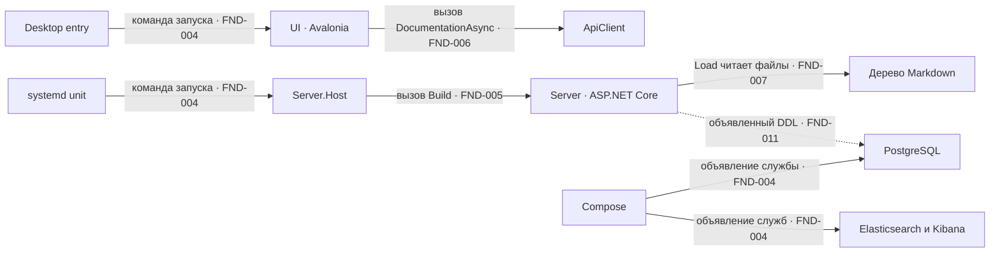

# Архитектурные представления

**Вопрос автора публикации.** Какие границы можно доказать из поставки? Критерий границы процесса — отдельная команда запуска. Критерий зависимости сборки — AssemblyRef или узел манифеста. Для вызова между компонентами нужен операнд IL либо наблюдение. Эти три вида связей имеют разную доказательную силу.

**Вопрос исследователя развёртывания.** Дескриптор рабочего стола и unit systemd задают разные команды. При штатном запуске предполагаются отдельные процессы UI и Host. В Host тело асинхронного метода вызывает сборку Server и затем ASP.NET Core. Основание для границы Host/Server — загрузка библиотеки внутри одного пути запуска. Compose описывает инфраструктуру данных. Фактическое число процессов на действующей установке неизвестно. FND-004, FND-005.

**Вопрос исследователя данных.** Файловое дерево документации, DTO ответа и строки поискового индекса имеют разные идентичности. Содержимое страницы может встречаться и в родительской папке, и в дочернем DTO. База хранит *объявленную* модель поисковых фрагментов. Для чтения локальной папки в опыте PostgreSQL не понадобился. FND-007, FND-010, FND-011.

**Границы вывода.** В документации поставщика агент и сервер описаны как взаимодействующие стороны. Связь по конкретной сети остаётся за пределами наблюдений этого снимка. Роль Specter и основания для её атрибуции описаны в [справочнике](../components/specter/reference.md).

Машиночитаемые графы сохраняют отдельный набор узлов для каждой цели разрешения зависимостей. Один и тот же пакет может иметь разные наборы зависимостей в графах Server и Host. [Графы пакетов](package-graphs.json) · [AssemblyRef и MVID](../analysis/assemblies.jsonl) · [Реестр выводов](../validation/findings.jsonl)

## Расширенная проверка

Для пути Server → PostgreSQL получено динамическое подтверждение записи и чтения в отдельном кластере. Для пути уведомления подтверждено обращение к интерфейсу SignalR. Сохранённая запись затем проверена в отдельном клиентском стенде. [Схема с границами наблюдений](../interactions/audit-event.md)
