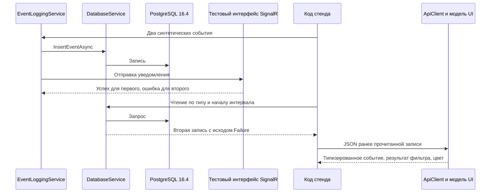

# Проверенный путь синтетического события

Переход от службы к отправке подтверждён IL и захватом вызова интерфейса. Оба события сохранились в PostgreSQL. Граница между серверным и клиентским стендами — сериализованная строка из журнала первого опыта. На втором стенде проверено, что прочитанная запись совместима с моделью клиента и что фильтр реагирует на текст, тип и время. Использование сетевого транспорта и отрисовка окна остаются открытыми. [Серверный журнал](../validation/postgres/run-1.jsonl) · [Клиентский журнал](../validation/presentation-and-data/run-1.jsonl) · [Данные IL](../analysis/method-evidence.json)

## Дополнение от 13 ноября

Новые опыты подтвердили лабораторный путь аудита через SignalR до штатного окна, наблюдаемый отказ защищённого HTTP-маршрута и работу раздельного маршрута чтения. Ранее описанные стенды сохранены. [Обновлённые результаты](../validation/continuation/results.md) · [Повторение](../validation/continuation/repeat.md)
