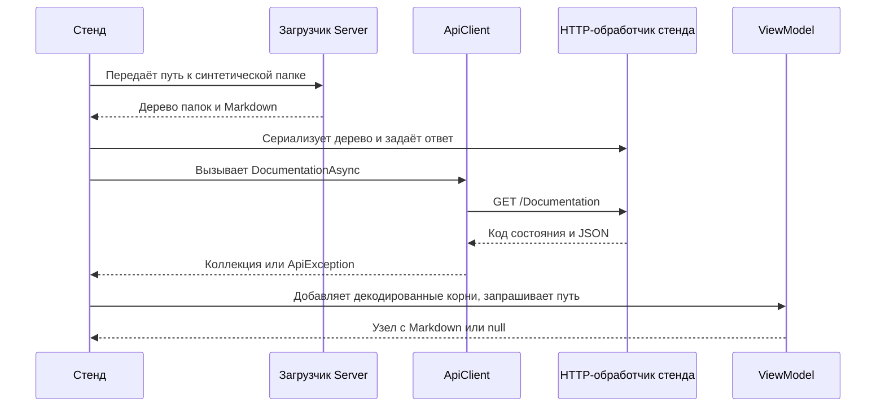

# Как встроенная страница доходит до модели UI

Обычный путь чтения подтверждают две стороны. В UI обнаружены вызовы DocumentationAsync и передача работы диспетчеру. Действие GetAllDocumentation имеет атрибут GET и вызывает GetDocumentation, затем Ok. В асинхронном теле GetDocumentation есть обращение к загрузчику каталога. FND-006. [Атрибуты контроллера](../analysis/server-metadata.json) · [Разобранные места IL](../analysis/method-evidence.json)

В опыте тестовый код соединял компоненты в четырёх местах. Эти соединения показаны явно.

Наблюдаемые переходы клиента в этой выборке начинаются с вызова DocumentationAsync. При 200 с массивом задача завершается с результатом. При 200 с null или при 503 задача завершается исключением. Последующий поиск существующего и отсутствующего пути проверен на дереве из успешного ответа. Переходы и исходные данные сохранены в записях FND-007–FND-010. [Журнал](../validation/documentation/run-1.jsonl) · [Исходный код стенда](../validation/documentation/Program.cs)
